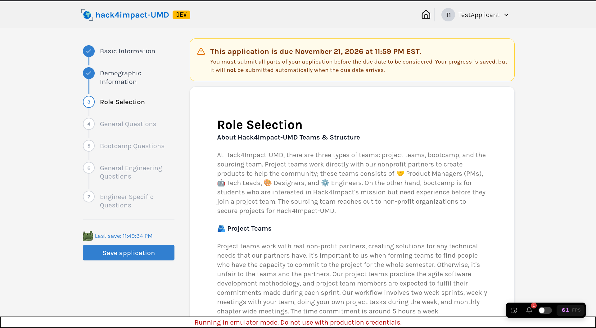
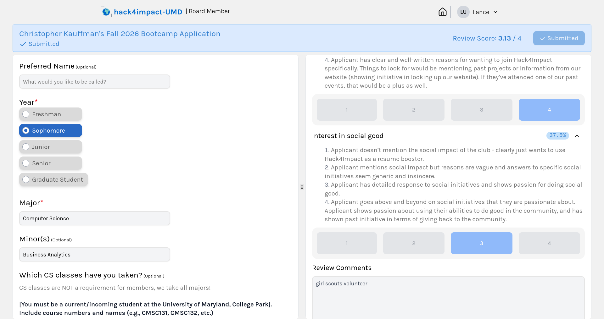
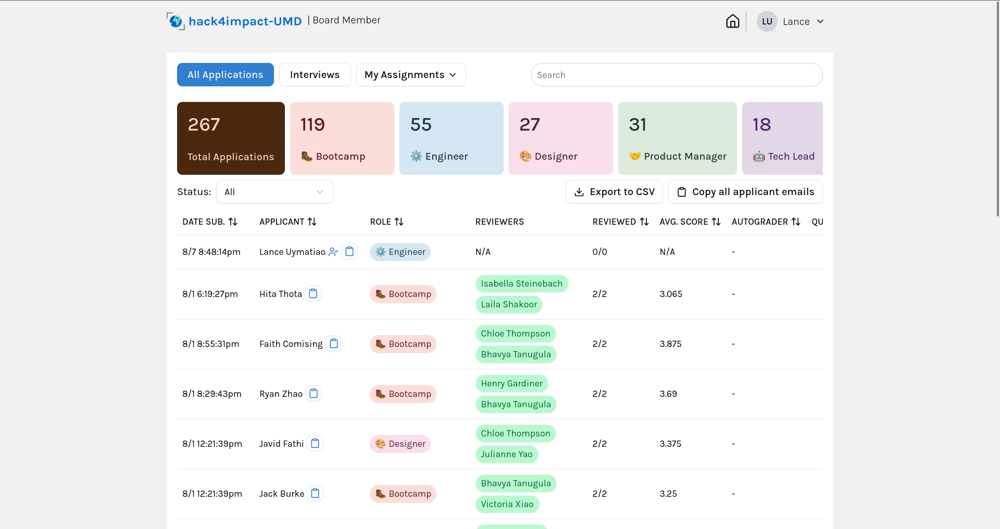
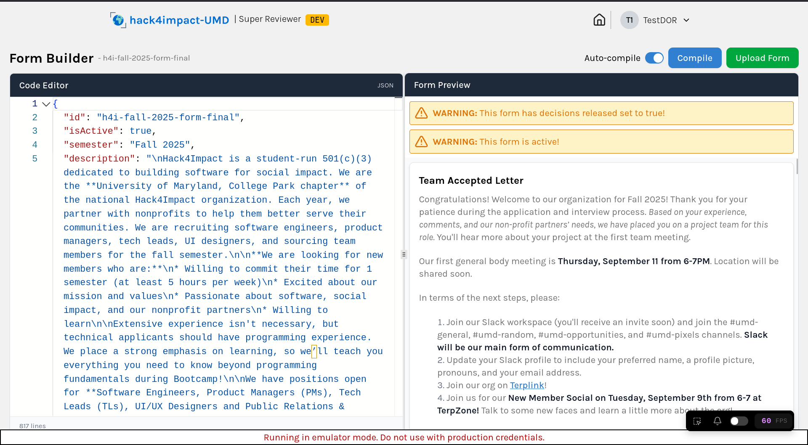
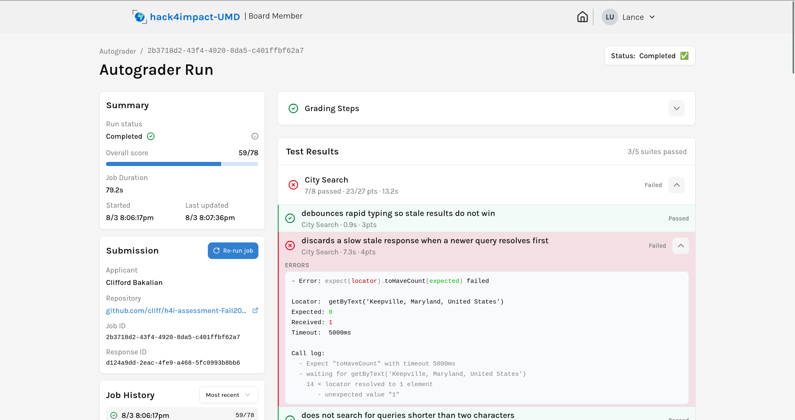

<p align="center"></p>

# 📝 Hack4Impact-UMD Application Portal

This repository contains the source code for the Hack4Impact-UMD Application Portal. The interface includes features for applicants to submit and view the status of their applications, and features to make reviewing applications more efficient for club members.

In addition, the project is integrated with [Professor](https://github.com/Hack4Impact-UMD/professor), our autograder service.

## ✨ Features

- **Role-specific workflows** for applicants, reviewers, board members, and admins.
- **Dynamic application forms** support role-specific sections, markdown, file uploads, autosave, and validation.
- **Review interface** with access to rubrics, notes, command pallete, and autosave.
- **Admin dashboards** manage review status, assignments, decisions, and confirmations.
- **Auto-assignment algorithm** generates applicant-to-reviewer matches.
- **Automation tools** duplicate forms, update due dates, activate forms, create internal applicants, etc.
- **Form and rubric builders** provide JSON editors, live previews, validation, and upload.
- **CSV exports** download and organize applicant and review data.
- **Autograder integration** publishes and tracks grading jobs for engineering applicants.

## 🛠️ Tech Stack

- **Language:** [TypeScript](https://www.typescriptlang.org/)
- **Package Manager**: [pnpm](https://pnpm.io/)
- **Linter and Formatter**: [oxlint + oxfmt](https://oxc.rs/)

### Frontend

- **Framework:** [React](https://reactjs.org/)
- **Build Tool:** [Vite](https://vitejs.dev/)
- **Styling:** [Tailwind CSS](https://tailwindcss.com/)
- **UI Components:** [shadcn/ui](https://ui.shadcn.com/), [Radix UI](https://www.radix-ui.com/)
- **Data Fetching:** [TanStack Query](https://tanstack.com/query/latest)
- **Routing:** [React Router](https://reactrouter.com/)

### Backend

- **Runtime:** [Node.js](https://nodejs.org/)
- **Framework:** [tRPC](https://trpc.io/)
- **Platform:** [Firebase](https://firebase.google.com/) (Cloud Functions, Firestore, Authentication, Storage)
- **Schema Validation:** [Zod](https://zod.dev/)
- **Task Queue:** [Cloud Tasks](https://cloud.google.com/tasks)

## 🚀 Building and Running Locally

1.  From the `app-portal` directory, install all dependencies with:
    ```bash
    pnpm install
    ```

2.  Build all workspaces:
    ```bash
    pnpm build
    ```
3.  Run the frontend server:
    ```bash
    pnpm --filter frontend dev
    ```

4.  Run the backend server:
    ```bash
    pnpm --filter functions serve
    ```

In addition:
- Set up `.env` files with the templates available at `frontend/.env.example` and `backend/functions/.env.example`.
- Set up backend emulators with the [Firebase Emulator Setup Guide](./backend/README.md).
- Set up pre-commit hooks with `pip install pre-commit` and `pre-commit install`

## 🖼️ Screenshots

### Applicant form



### Applicant status page


### Application review



### Board member dashboard



### Form builder



### Autograder run



## 📞 Team Contacts

| Name | Role | Contact | Email |
|------|------|---------|-------|
| **Ramy Kaddouri** | Tech Lead | [Slack](https://hack4impact.slack.com/) | [TODO](mailto:lanceu0128@gmail.com) |
| **Lance Uymatiao** | Tech Lead | [Slack](https://hack4impact.slack.com/) | [lanceu0128@gmail.com](mailto:lanceu0128@gmail.com) |
